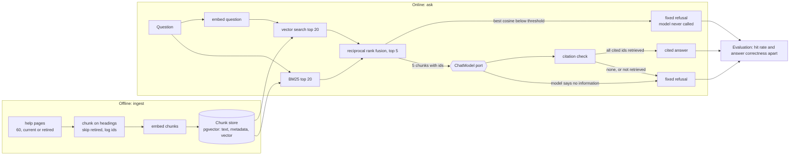

# Architecture: ai-cited-answers

A question-answering service over a help center. Offline, it turns current pages into chunks with metadata and indexes them twice (keywords and vectors). Online, it retrieves five chunks for a question by fusing the two lists, refuses early when the best match is too weak, asks a model to answer with a citation for every claim, and checks the citations in code before the reader sees the answer. An evaluation runner grades retrieval and answers apart. This document names the parts, follows one question through them, and says what a production version would add.

## Pattern

Ports and adapters (hexagonal), in four folders. The system has three boundaries that must be replaceable (the model, the embedder, the chunk store) and a body of rules that must not depend on any of them (chunking, fusion, the citation check, the refusal rules, the statistics). The domain holds the rules and is tested without a database or a model. The same application code runs against an in-memory store in unit tests and against Postgres with pgvector in the service.

## Components

| Component | Layer | Owns |
| --- | --- | --- |
| `domain.pages`, `domain.chunking` | domain | page files (front matter, headings), chunks with page id, heading path, date and status; retired pages are skipped and reported |
| `domain.retrieval` | domain | the tokenizer, BM25, cosine, reciprocal rank fusion |
| `domain.answering` | domain | the fixed refusal message, citation extraction and check, the threshold tuning |
| `domain.evaluation` | domain | question types, Wilson intervals, hit at k, verdict parsing, the retrieval/generation split of misses |
| `domain.llm`, `domain.errors`, `domain.prompts` | domain | vendor-neutral request/response/usage, named errors, the prompt value object |
| `application.retrieve` | application | `ingest` (chunk, embed, store) and `HybridRetriever` (vector, keyword, fused; best similarity) |
| `application.answer` | application | `AnswerService`: retrieve, refuse below the threshold, call the model, check citations |
| `application.judge`, `application.evaluate`, `application.threshold` | application | the grading model, the two-part evaluation, the dev-only threshold choice |
| `application.ports` | application | `ChatModel`, `Embedder`, `ChunkStore`, `PageSource`, `QuestionSource`, `PromptStore`, `Clock` |
| `infrastructure.pg_store`, `memory_store` | infrastructure | Postgres with pgvector, and the in-memory store used by tests |
| `infrastructure.embeddings` | infrastructure | the OpenAI-compatible embedder, its recording and its replay |
| `infrastructure.recording`, `openai_compatible`, `anthropic_chat`, `resilient` | infrastructure | model replay/record, local-server client, Claude client, retry with backoff |
| `infrastructure.files`, `settings`, `wiring`, `logging`, `shutdown` | infrastructure | page/question/prompt readers, validated environment configuration, wiring, logfmt logs, signals |
| `interfaces.cli`, `render` | interfaces | the `cited` command and the report text |
| `interfaces.http`, `server` | interfaces | the FastAPI app (`/ask`, `/health`) and the uvicorn entry point |

Dependencies point inward: import-linter fails `make lint` if `domain` or `application` imports an SDK, an HTTP client, `psycopg` or a web framework, or if a lower layer imports a higher one.

## Data flow

Drawn versions of this figure and of the walk-through: [the architecture](docs/diagrams/architecture.svg) and [one run](docs/diagrams/flow.svg).

One question, in order:

1. `POST /ask` validates the body (3 to 500 characters, no extra fields) and gives the request an id.
2. The question is embedded. Vector search returns the 20 nearest chunk ids with their cosine similarity (in SQL, `ORDER BY embedding <=> $1, id`; the HNSW index can serve it, but on a corpus this small Postgres reads the whole table, so the result is exact). BM25 returns the 20 best keyword matches over chunk text with the heading path prepended.
3. Reciprocal rank fusion (`1 / (60 + rank)` summed over the lists) picks the top five. For each of the five the similarity to the question is known, from the vector list or by one more query, and the highest is the retrieval confidence.
4. If that confidence is below the threshold from `evals/threshold.json`, the reader gets the fixed refusal and the model is never called.
5. Otherwise the prompt lists the five chunks, each under its id in square brackets, and asks for one to three sentences with an id after every claim. If the model call fails, the service logs `model unavailable` and answers HTTP 503 instead; no answer or refusal is produced.
6. The reply is checked in code. If it is the refusal sentence, the reader gets the refusal (reason `model_refused`). If it cites nothing, or cites an id that was not among the five retrieved for this request, it is replaced by the refusal and the reason is logged (`no_citation`, `citation_not_retrieved`). A citation that names only a page is read as that page's chunk when exactly one chunk of that page was retrieved.
7. The response carries the status, the answer, the reason, and for each citation the chunk id, page id and heading path, so a reader can open the source. Only now does the service log the request: its id, a hash of the question and its length, never the text.

## Decisions and trade-offs

Records for the larger choices are in [docs/adr](docs/adr).

- **Hybrid retrieval by rank fusion** ([0001](docs/adr/0001-hybrid-retrieval-by-rank-fusion.md)). Keyword and vector search fail on different questions, and RRF combines lists without calibrating their scores. In this corpus fusion did not beat vectors alone (the corpus is small and the vector model is good at codes), which the report states instead of hiding.
- **Retired pages never enter the index, and the database enforces it** ([0002](docs/adr/0002-retired-pages-stay-out-of-the-index.md)). A filter at query time is one forgotten `WHERE` away from serving a contradicted answer; a `CHECK (status = 'current')` constraint cannot be forgotten.
- **The refusal threshold is on cosine similarity, tuned on dev** ([0003](docs/adr/0003-refusal-threshold-on-cosine-tuned-on-dev.md)). Fused scores are rank-based and carry no information about quality; similarity does.
- **Citations are checked in code against the retrieved set** ([0004](docs/adr/0004-citations-are-checked-in-code.md)). The model is advised to cite; the check is what makes a reader's click safe.
- **Grade the two halves apart** ([0005](docs/adr/0005-grade-retrieval-and-answers-apart.md)). A wrong answer is a retrieval miss or a generation miss, and the fix is different.
- **Recorded models, hand-graded judge** ([0006](docs/adr/0006-recorded-models-and-a-hand-checked-judge.md)). Offline, repeatable numbers; the judge's agreement with human grades is a reported figure, not an assumption.
- **A whole-index rebuild in one transaction.** `replace_all` deletes and reinserts every chunk atomically, so a reader never sees a half-built index. At 68 chunks that costs a few seconds; a per-page upsert is the natural extension.

## Failure modes the lesson teaches, and where the code shows them

| Failure | Where it shows |
| --- | --- |
| A retired page contradicts a current one and gets served | the three retired pages; chunking skips them; the `CHECK` constraint; `sql/003_queries.sql` query 3 |
| A keyword index misses a bare error code because of its tokenizer | `whitespace_tokenize` against `tokenize`, in `tests/e2e` ("What's E2091 about?") |
| A small model echoes a placeholder citation | the prompts show a real id; `test_a_literal_placeholder_citation_is_rejected_like_any_unretrieved_id` |
| A citation to a real chunk that was not retrieved this time | `check_citations` compares with the retrieved set, not the index |
| A close paraphrase of an answerable topic clears the threshold | the four test slips in the README; the threshold and the model are two lines of defense, and in this run they did not hold for these four |
| A correct sentence with no citation | prompt v1: 0 of 90 test answers survived the check; prompt v2 fixed it |
| Tuning the threshold on the set the result is reported on | the threshold is tuned on `dev` only, written to `evals/threshold.json`, and the test numbers are measured with it |
| An unverified judge | 30 hand grades and a reported agreement (97%) |

## Limits of the teaching build

- 68 chunks. A production index would add an ANN index with tuned parameters, a keyword index inside the database (`tsvector` or BM25 in the engine) rather than in the process, and incremental re-indexing triggered by page changes.
- One generator and one judge, both a 1.5-billion-parameter model. A production system would use a stronger generator, a different model as judge, a reranker, and a second-pass verifier for refusals.
- No authentication, authorization or rate limiting on `/ask`; no per-tenant scopes on chunks.
- The embeddings come from one model with no query/document prefixes, and are stored in a `vector(768)` column; a model change means re-embedding and a column change.
- The service builds its keyword index in memory at start; a page change needs `reload()` or a restart.

## How to extend it

- **Another model:** add an adapter that implements `ChatModel` (or `Embedder`), register it in `model_factory` or `wiring`, record with `RECORD=on`.
- **A reranker (stretch):** put a `Reranker` port between `HybridRetriever` and `AnswerService`, take the top 20 from fusion and keep five.
- **Access scopes (stretch):** add `audience` to `Chunk` and to the `chunks` table, pass the caller's audience into `ChunkStore.vector_search`, and add a test that a customer question never returns a staff chunk.
- **Re-index one page (stretch):** add `ChunkStore.replace_page(page_id, chunks, vectors)` and call it from a new `cited reindex <page>` command; BM25 is rebuilt from the store on `reload()`.
