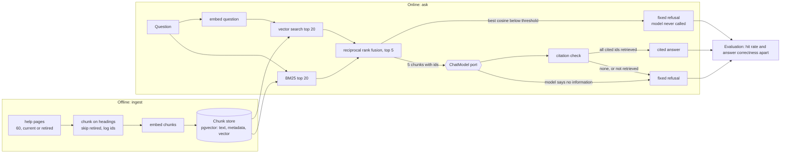

# Mermaid diagrams

## What it is

**Mermaid** is a way to draw diagrams by writing text. You put the description inside a code fence marked `mermaid`; a viewer that supports it (GitHub does) turns the text into a picture. A **flowchart** is a diagram of boxes (**nodes**) joined by arrows (**edges**), usually showing how data or control moves through a system.

## Why this repository uses it

`ARCHITECTURE.md` explains how the system is organized, and a picture of the parts and the arrows between them is the fastest way to see that. Because the picture is text, it lives in version control: a change to the design is a visible change in a diff, and nobody has to maintain a separate image file.

## Where it appears

| File | What it does with this technology |
| --- | --- |
| `ARCHITECTURE.md` | the diagram |

## How it works underneath

The viewer loads the Mermaid library, which parses the text into a graph (nodes and edges), computes a layout, and draws it as SVG. Node ids (`PG`, `CH`) are only names used to connect arrows; the visible text is the label in brackets. The shape of the brackets chooses the shape of the node: `[text]` a box, `[(text)]` a database cylinder, `{text}` a diamond (a decision), `{{text}}` a hexagon. `<br/>` inside a label starts a new line. An arrow can carry a label between pipes: `A -->|label| B`.

## Walkthrough of this repository's use

The diagram in `ARCHITECTURE.md`:



Line by line:

- `flowchart LR`: the diagram type is a **flowchart**; `LR` means it is laid out left to right.
- `subgraph offline[Offline: ingest]`: starts a labeled group (a box around the nodes up to the matching `end`) named `offline`, titled "Offline: ingest".
- `PG[help pages<br/>60, current or retired] --> CH[chunk on headings<br/>skip retired, log ids]`: draws an arrow from `PG` (a box labeled "help pages / 60, current or retired") to `CH` (a box labeled "chunk on headings / skip retired, log ids").
- `CH --> EM[embed chunks]`: draws an arrow from `CH` (defined earlier: a box labeled "chunk on headings / skip retired, log ids") to `EM` (a box labeled "embed chunks").
- `EM --> ST[(Chunk store<br/>pgvector: text, metadata, vector)]`: draws an arrow from `EM` (defined earlier: a box labeled "embed chunks") to `ST` (a database cylinder labeled "Chunk store / pgvector: text, metadata, vector").
- `end`: closes the group.
- `subgraph online[Online: ask]`: starts a labeled group (a box around the nodes up to the matching `end`) named `online`, titled "Online: ask".
- `Q[Question] --> QE[embed question]`: draws an arrow from `Q` (a box labeled "Question") to `QE` (a box labeled "embed question").
- `QE --> VS[vector search top 20]`: draws an arrow from `QE` (defined earlier: a box labeled "embed question") to `VS` (a box labeled "vector search top 20").
- `Q --> KW[BM25 top 20]`: draws an arrow from `Q` (defined earlier: a box labeled "Question") to `KW` (a box labeled "BM25 top 20").
- `ST --> VS`: draws an arrow from `ST` (defined earlier: a database cylinder labeled "Chunk store / pgvector: text, metadata, vector") to `VS` (defined earlier: a box labeled "vector search top 20").
- `ST --> KW`: draws an arrow from `ST` (defined earlier: a database cylinder labeled "Chunk store / pgvector: text, metadata, vector") to `KW` (defined earlier: a box labeled "BM25 top 20").
- `VS --> RRF[reciprocal rank fusion, top 5]`: draws an arrow from `VS` (defined earlier: a box labeled "vector search top 20") to `RRF` (a box labeled "reciprocal rank fusion, top 5").
- `KW --> RRF`: draws an arrow from `KW` (defined earlier: a box labeled "BM25 top 20") to `RRF` (defined earlier: a box labeled "reciprocal rank fusion, top 5").
- `RRF -->|best cosine below threshold| REF1[fixed refusal<br/>model never called]`: draws an arrow, with the label "best cosine below threshold" from `RRF` (defined earlier: a box labeled "reciprocal rank fusion, top 5") to `REF1` (a box labeled "fixed refusal / model never called").
- `RRF -->|5 chunks with ids| M{{ChatModel port}}`: draws an arrow, with the label "5 chunks with ids" from `RRF` (defined earlier: a box labeled "reciprocal rank fusion, top 5") to `M` (a hexagon labeled "ChatModel port").
- `M --> CHK[citation check]`: draws an arrow from `M` (defined earlier: a hexagon labeled "ChatModel port") to `CHK` (a box labeled "citation check").
- `CHK -->|all cited ids retrieved| ANS[cited answer]`: draws an arrow, with the label "all cited ids retrieved" from `CHK` (defined earlier: a box labeled "citation check") to `ANS` (a box labeled "cited answer").
- `CHK -->|none, or not retrieved| REF2[fixed refusal]`: draws an arrow, with the label "none, or not retrieved" from `CHK` (defined earlier: a box labeled "citation check") to `REF2` (a box labeled "fixed refusal").
- `M -->|model says no information| REF2`: draws an arrow, with the label "model says no information" from `M` (defined earlier: a hexagon labeled "ChatModel port") to `REF2` (defined earlier: a box labeled "fixed refusal").
- `end`: closes the group.
- `ANS --> EV[Evaluation: hit rate and answer correctness apart]`: draws an arrow from `ANS` (defined earlier: a box labeled "cited answer") to `EV` (a box labeled "Evaluation: hit rate and answer correctness apart").
- `REF1 --> EV`: draws an arrow from `REF1` (defined earlier: a box labeled "fixed refusal / model never called") to `EV` (defined earlier: a box labeled "Evaluation: hit rate and answer correctness apart").
- `REF2 --> EV`: draws an arrow from `REF2` (defined earlier: a box labeled "fixed refusal") to `EV` (defined earlier: a box labeled "Evaluation: hit rate and answer correctness apart").

## Try it yourself

1. Find the fence that starts the diagram.

```bash
grep -n 'mermaid' ARCHITECTURE.md
```

What you should see (captured from this repository):

```text
33:```mermaid
```

2. How many lines of Mermaid text the diagram has.

```bash
awk '/```mermaid/{f=1;next} /```/{f=0} f' ARCHITECTURE.md | wc -l | tr -d ' '
```

What you should see (captured from this repository):

```text
24
```

3. How many arrows (solid, with or without a label) it draws.

```bash
awk '/```mermaid/{f=1;next} /```/{f=0} f' ARCHITECTURE.md | grep -c -- '-->'
```

What you should see (captured from this repository):

```text
19
```

## Mistakes people make

- **Reusing a node id for two things.** The second definition would replace the first. Ids are unique.
- **A label with brackets or quotes.** They can end the node early; labels here avoid them.
- **Expecting every viewer to draw it.** Some editors show the text. The surrounding paragraphs say the same thing in words.
- **Forgetting `end` after `subgraph`.** The group would swallow the rest of the diagram.

## Check yourself

1. What does `A -->|yes| B` draw?

   *Answer:* An arrow from A to B labeled "yes".

2. Which brackets draw a database cylinder?

   *Answer:* `[( ... )]`.

3. What does `flowchart LR` set?

   *Answer:* A flowchart laid out left to right.

4. What is a node id for?

   *Answer:* To connect edges; the visible text is the label.

5. What does `-.->` draw?

   *Answer:* A dotted arrow.

## Further reading

- Mermaid documentation, https://mermaid.js.org/syntax/flowchart.html (the diagrams could not be rendered in this session; the explanation was generated from the diagram text by a parser that stops on any syntax it does not know).
